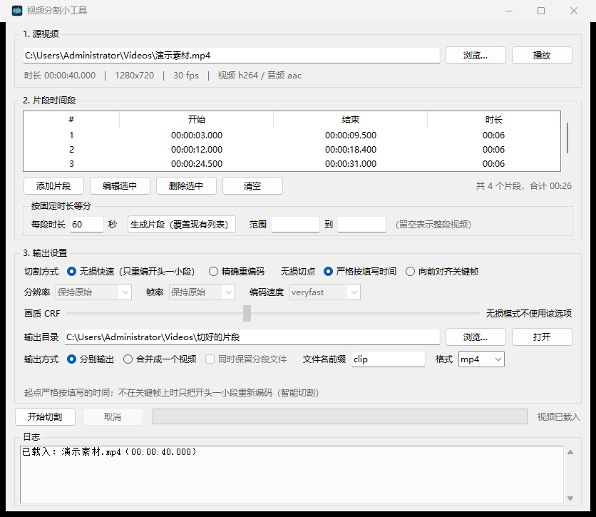
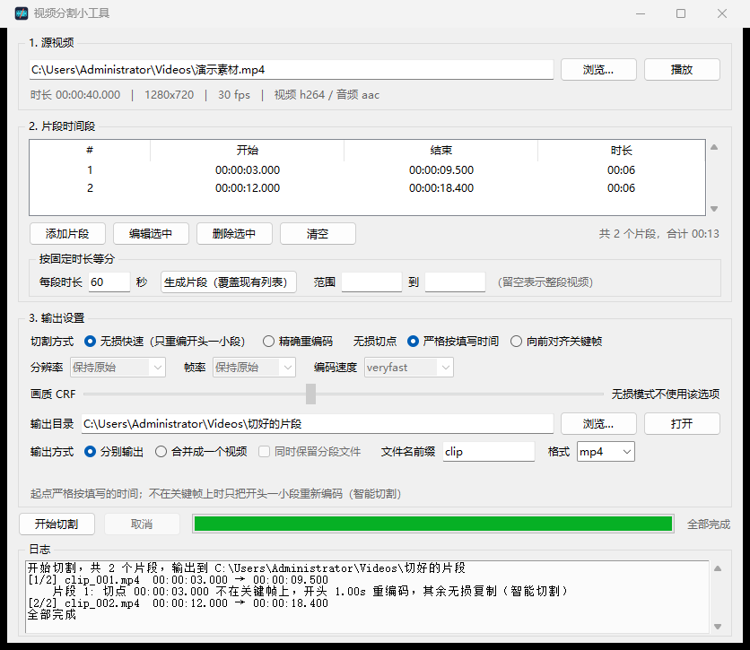

# 视频分割小工具 · vidslice

**中文** | [English](README.en.md)

> 从一段视频里切出若干片段，也能把片段合并回一个视频。Windows 桌面程序，**轻量、免安装、全离线**。

<p align="center">
  
</p>

<p align="center">
  
  
  
  
  
</p>

选好视频 → 添加时间段（或按固定时长等分）→ 选输出参数 → 一键切割。全程本地处理，不上传、不联网、不装运行库。

**为什么这么小**：整包 **15 MB**，单文件 exe **17 MB**。里面包含裁剪过的 Python 运行时和一份**自己编译的精简版 ffmpeg**（只编入实际用到的组件，替代官方 293 MB 的全量构建）。原版做同样的功能要约 480 MB。

## 特点

- **无损切割**：直接复制码流，不重新编码，速度极快、画质零损失
- **智能切割（smart cut）**：起点不在关键帧上时，只把开头那一个 GOP 重新编码——**起点精确到填写的时间，开头也不卡顿**，这是纯 `-c copy` 做不到的
- **精确重编码**：可同时改分辨率、帧率、画质（CRF）
- **合并成一个视频**：无损拼接 + 自动校验时长 + 校验不过自动降级重编码，不会静默交付错文件
- **按固定时长等分**：几秒切一整集，支持指定区间
- 片段列表可编辑、可多选删除，双击可预览
- 全中文界面，窗口自适应，屏幕放不下时自动出滚动条

<p align="center">
  
</p>

上图日志里那行「切点不在关键帧上，开头 1.00s 重编码，其余无损复制（智能切割）」就是智能切割在起作用。

## 下载

到 [Releases](../../releases) 页面按需选一个：

| 文件 | 体积 | 说明 |
|---|---|---|
| `vidslice-v1.0.0-win64.exe` | 17 MB | **单文件**，双击即用，什么都不用解压 |
| `vidslice-v1.0.0-win64.zip` | 15 MB | 解压即用，启动比单文件版快约 1 秒 |

两者功能完全一致。单文件版每次启动会把内置组件解压到系统临时目录，所以首次启动稍慢（2–5 秒），之后约 1.3 秒。

## 使用

1. 选择源视频，程序会自动读出时长、分辨率、帧率、编码格式
2. 「添加片段」手动填开始/结束时间（支持 `90`、`1:30`、`00:01:30.500`），或用「按固定时长等分」批量生成
3. 选切割方式和输出参数，点「开始切割」

需要排查问题时，用包里的 `调试运行.bat` 启动，它会保留控制台窗口显示报错。

## 技术栈

| 层 | 选型 | 说明 |
|---|---|---|
| 界面 | Python 3.12 + Tkinter | 标准库自带，无第三方依赖 |
| 切割/合并 | ffmpeg 8.1.2（自建精简版） | 只编入实际用到的组件 |
| 运行环境 | `tools/` 内置 | 不改动系统环境，删除目录即卸载 |

不需要装 Python、不需要装 ffmpeg，也不写注册表——删掉目录就是卸载。

## 界面说明

**1. 源视频** — 选文件后自动读取时长、分辨率、帧率、编码格式。点「播放」用**系统默认播放器**打开原片（为了压包体没有内置播放器）；双击某个片段会用同一个播放器打开，并在日志里提示该片段的起止时间。

**2. 片段时间段**

- **添加片段**：手动填开始/结束时间，支持 `90`、`1:30`、`00:01:30.500` 三种写法。
- **按固定时长等分**：填「每段时长」，可选「范围」（留空表示整段视频），点生成后覆盖现有列表。
- 双击列表某行可直接预览该片段；支持多选删除、编辑选中。

**3. 输出设置**

| 选项 | 可选值 |
|---|---|
| 切割方式 | 无损快速 / 精确重编码 |
| 无损切点 | 严格按填写时间（默认） / 向前对齐到关键帧 |
| 分辨率 | 保持原始、1080p、720p、480p、360p，也可直接输入 `1280x720` |
| 帧率 | 保持原始、24、25、30、50、60，也可直接输入其他数值 |
| 画质 CRF | 16–32，数值越小画质越好、体积越大 |
| 编码速度 | ultrafast → slow，越慢压得越小 |
| 输出目录 | 目标文件夹，切割前会自动创建 |
| 输出方式 | 分别输出多个片段 / 合并成一个视频 |
| 文件名前缀 | 分别输出时为 `前缀_001.mp4`；合并时为 `前缀_merged.mp4` |
| 输出格式 | mp4、mkv、mov |

分辨率、帧率、CRF、编码速度仅在「精确重编码」下生效，无损模式下会自动置灰。

## 两种切割方式（重点）

### 无损快速（默认）

主体是 `-c copy` 直接复制码流，不重新编码。速度极快，画质零损失。

因为切点必须落在关键帧上，这里有两种「无损切点」策略：

**严格按填写时间（默认）** — 起点严格按你填写的时间，不做任何挪动。

实现方式是**智能切割（smart cut）**：如果切点不在关键帧上，程序只把 `[起点, 下一个关键帧)` 这一小段**重新编码**（让片段的第一帧成为真正的关键帧），剩下的部分照原样无损复制，最后拼成一个文件。

这样就同时拿到了三件事：

- 起点严格等于填写的时间；
- 片段从真正的关键帧起播，**不会出现开头卡顿**；
- 文件里没有隐藏的预滚数据，体积正常，**无损合并也不会错位**。

代价：头部那一个 GOP 是有损重编码的（长度最多一个关键帧间隔，常见视频 1–2 秒）。另外，编码格式不是 h264/hevc、像素格式不是 yuv420p、或音轨不是 aac 的源（例如 10-bit、4:2:2、VP9、mp3 音轨），会退化为**整段重编码**并在日志里说明原因。

**向前对齐到关键帧** — 起点往前挪到最近的关键帧，整段纯复制，不做任何重编码。

好处：完全不重编码，速度最快。
代价：片段开头可能多出一点画面（最多一个关键帧间隔），日志会写明多出多少。

两种策略都**保证片段覆盖你填写的区间**。片段的结束位置都不受限制；末尾可能多出约 2 帧（`-c copy` 按包截断的固有行为）。

### 精确重编码

用 libx264 重新编码，起点和终点都严格按填写的时间执行（实测偏差约 0.02 秒）。可以同时改分辨率、帧率、画质。

**代价**：慢，且整段都是有损重编码。

> 一般来说：只做剪切、要求快 → 无损（智能切割）；完全不重编码 → 无损 + 向前对齐；要改分辨率/帧率 → 精确重编码。

## 合并成一个视频

在「输出方式」里选 **合并成一个视频**，程序会先把每个片段切到临时目录，再用 concat demuxer 拼接成一个文件。

- 默认**无损拼接**（`-c copy`），不重新编码。
- 拼接完成后会**自动校验**结果时长与各片段之和是否一致；不一致就自动改用重编码再拼一次；仍不一致则报错，**不会悄悄交付一个错误的文件**。
- 勾选「同时保留分段文件」可以把中间产物一并留到 `输出目录/前缀_parts/`，否则临时目录会自动清理。

### 无损切点与合并的关系

智能切割让每个片段都以真正的关键帧开头、且不含隐藏数据，所以**严格切点也能走通无损合并**。用一段 640×360、30fps、有音轨、关键帧每 2 秒的素材实测（切 3–8s 与 20–25s，共填写 10.000s）：

| 版本 | 各段之和 | 无损拼接结果 | 是否降级重编码 |
|---|---|---|---|
| 智能切割之前 | 10.199s | 11.203s（隐藏预滚被暴露，泄漏 1.004s） | 是，降级后 10.221s |
| 智能切割之后 | 10.197s | 10.197s | **否，无损拼接通过** |

之所以以前会泄漏：`-c copy` 拼接时会丢掉 mp4 的 edit list，于是片段开头那段隐藏的预滚数据暴露出来。现在片段本身不含隐藏数据，问题从根上不存在了。校验与自动降级仍然保留，作为兜底。

## 包体构成

| 部分 | 解压后 | 说明 |
|---|---|---|
| `tools/python/` | 24.9 MB | 已裁掉 `site-packages`、`idlelib`、`lib2to3`、`venv`、`asyncio`、`email`、`xml`、SSL/SQLite、Tix、tcl 示例、`__pycache__` 等 |
| `tools/ffmpeg/` | 21.5 MB | `ffmpeg.exe` 15.1 MB + `ffprobe.exe` 6.2 MB + 2 个运行时 DLL 0.2 MB |
| `app/` `tests/` | 0.2 MB | 代码本体 |
| **合计** | **44.6 MB** | 打成 zip 后 **15.2 MB** |

`ffprobe` 只有 6.2 MB，因为它**不需要任何编码器**——单独用 `tools/build/build-ffprobe-min.sh` 编译，
去掉 libx264/libx265 和全部编码器，比 `ffmpeg.exe` 小了一半以上。

两点说明：

- 首次启动后 Python 会重新生成约 1~2 MB 的字节码缓存（`__pycache__`），属正常现象。
- 原始版本是 482 MB（官方 ffmpeg 三个静态 exe 就占 293 MB），现在整包 15.2 MB。

## 仓库与发行

**仓库只放源码。** 二进制运行时（`tools/python/`、`tools/ffmpeg/`）在 `.gitignore` 里被排除，
仓库体积约 170 KB，克隆/拉取都很快。发行包作为 Release 附件提供。

提供两种发行形态，按需选一个（或都放上）：

| 形态 | 体积 | 首次启动 | 说明 |
|---|---|---|---|
| **单文件 exe** | 17.2 MB | 约 2–5 秒（冷）/ 1.3 秒（热） | 双击即用，什么都不用解压。运行时会把内置文件解到系统临时目录，所以启动慢一点 |
| **文件夹 + zip** | 15.2 MB（zip）/ 44.6 MB（解压） | 约 0.3 秒 | 解压即用，启动最快，但不是单文件 |

单文件 exe 用 PyInstaller 打包，内置的 ffmpeg/ffprobe 会被解压到 `sys._MEIPASS`，
`find_tool()` 已经会优先到那里找，所以两种形态共用同一份代码。

重新打包：

```powershell
# 单文件 exe（需要一个装了 PyInstaller 的 Python，不能用 tools/python——
# 那个已裁掉 pip 和 SSL）
C:\pybuild\python.exe -m pip install pyinstaller
powershell -ExecutionPolicy Bypass -File tools\build\build-exe.ps1

# 文件夹 + zip
Compress-Archive -Path <解压目录> -DestinationPath dist\视频分割小工具-v1.0.0-win64.zip
```

> **发布前注意**：`ffmpeg.exe` 是 GPL 构建，分发时需要同时提供对应源码或书面获取承诺，
> 详见 [THIRD-PARTY-NOTICES.md](THIRD-PARTY-NOTICES.md)。

## 图标

`assets/icon.svg` 是矢量源文件，`assets/icon.ico` 是从它生成的多尺寸图标（16/24/32/48/64/128/256），
会被编进 exe，同时用作窗口图标。

改图标的流程：

```bash
# 1. 编辑 assets/icon.svg
# 2. 重新生成 .ico 和预览图（需要 Pillow）
C:\pybuild\python.exe tools\build\make-icon.py assets/icon.svg \
    --ico assets/icon.ico --preview build\icon-preview.png
# 3. 看预览图确认各尺寸都清楚，然后重新打包
```

`make-icon.py` 用系统自带的 Chromium 内核浏览器（Edge）无头渲染，因为它是唯一能输出
**带 alpha 通道** PNG 的现成方案——透明的圆角外侧才会正确，否则任务栏上会看到一个白方块。

`.ico` 的编码是脚本自己写的，没有用 Pillow 的 ICO 保存，原因是 **Pillow 会把所有尺寸都存成
PNG 条目，而 Windows 只对 256px 认 PNG，小尺寸必须用未压缩的 BMP(DIB)**，否则资源管理器可能
显示成默认的通用图标。代价是文件从 ~28 KB 涨到 ~112 KB，在 17 MB 的 exe 里可以忽略。
脚本会在生成后校验这一点，不满足就直接报错。

> 图标设计上的两点约束（写 `icon.svg` 时要遵守）：**只用纯色**（渲染链路对渐变支持不稳，
> 且渐变缩到 16px 会糊）；**元素要少**，缩到 16px 时至少要能读出一两个主要形状。

> 改了图标后如果资源管理器还显示旧图标，那是**图标缓存**：把 exe 换个文件名即可立刻看到，
> 或者执行 `ie4uinit.exe -show` 刷新缓存。

## 目录结构

```
视频分割工具.bat                启动器（双击运行）
调试运行.bat                    带控制台的启动器
app/
  main.py                       Tkinter 界面
  splitter.py                   切割与合并的命令拼装、后台任务
  ffmpeg_tools.py               ffmpeg/ffprobe 定位、视频信息与关键帧探测
  segments.py                   时间段解析、格式化、等分
tools/
  python/                       Python 3.12.10（含 Tkinter，已裁剪）
  ffmpeg/                       自建精简版 ffmpeg + ffprobe
  build/
    build-ffmpeg-min.sh         精简版 ffmpeg 的可复现编译配方
    build-ffprobe-min.sh        精简版 ffprobe（无编码器，体积减半）
    build-exe.ps1               打包成单文件 exe
    make-icon.py                SVG 图标 → 多尺寸 .ico + 预览图
assets/
  icon.svg                      图标矢量源文件（改图标改这个）
  icon.ico                      多尺寸图标，编进 exe 并用作窗口图标
docs/                           README 用的界面截图
tests/                          自测脚本
```

## 自测

```bat
tools\python\python.exe tests\smoke_test.py   :: 核心逻辑 + 真实切割 + 合并
tools\python\python.exe tests\gui_test.py     :: 界面构建、交互、完整合并流程
```

`smoke_test.py` 共 142 项检查。它不只是比对时长，还会读**输出文件的实际画面**来验证切点：

- 构造一段「每秒灰度递增」的视频（第 i 秒灰度 = 12×i），切完之后读第一帧灰度，就能反推画面到底切在第几秒。只测时长是不够的——切错位置时长也可能对得上。
- 覆盖：时间解析、分辨率缩放、等分、关键帧探测、两种无损切点的内容准确性、智能切割（首个关键帧是否在 0 秒、有无隐藏预滚、无后续关键帧时整段重编码、拼接校验失败降级、取消、临时目录清理、hevc 源）、无损/重编码的内容准确性、无损合并（逐点核对画面）、带音轨合并、重编码合并、合并失败降级、中文路径、后台任务进度与清理。

`gui_test.py` 共 70 项检查，包含一次走完整界面的合并（拦截弹窗后自动驱动事件循环），以及布局断言：默认尺寸下所有控件完整可见、内容超出视口时滚动条自动出现且底部可达、窗口放大后日志区变高、图标资源可定位。

`tests/diagnose_cut.py` 与 `tests/diagnose_merge.py` 是两份诊断脚本，保留了两轮选型时的对照数据（不同 ffmpeg 命令写法的偏差、两种切点模式在密集/稀疏关键帧素材下的画面、帧数与体积），调整参数时可以拿它们复测。

## 许可

本项目代码采用 [MIT 许可](LICENSE)。随包分发的 ffmpeg 是 GPL 构建，另有其义务，
详见 [THIRD-PARTY-NOTICES.md](THIRD-PARTY-NOTICES.md)。

## 已修复的坑

这些都是实测踩出来的，记录在此避免回退。

**1. 无损模式不能加 `-avoid_negative_ts make_zero`。**
加了之后，关键帧稀疏的视频上 3 秒的请求会切出 7 秒（+2.07s）。原因是 ffmpeg 会把关键帧到切点之间的预滚数据写进文件并用 edit list 隐藏，`make_zero` 把这个偏移去掉，隐藏数据就暴露了。

**2. 非关键帧起点直接 `-c copy` 会让片段开头卡顿。**
这是用户实际反馈的问题。ffmpeg 为了在非关键帧处精确起点，会把「上一个关键帧 → 起点」的预滚数据写进文件再用 edit list 藏起来，于是片段的呈现时间轴从 GOP 中间开始，**首帧不是真正的关键帧**，播放器从缺失参考帧的位置起播就会出现明显卡顿。解决办法是智能切割（把开头一个 GOP 重新编码成自包含的关键帧）。修好后实测：首个关键帧 0.700s → **0.000s**，容器帧数从 182（含 39 个隐藏帧）降到 **143**（= 解码帧数）。

**3. 切点对齐只能往前，绝不能"取最近的关键帧"。**
最初写成取最近的关键帧，结果请求 4.6 秒的片段被切到了 8.33 秒，请求 2.0 秒的被切到 0 秒；当最近的关键帧落在结束时间之后时，甚至只能切出 2 帧。现在只保留「向前对齐」这一种对齐方式，且默认根本不挪动切点。

**4. 合并的自检不能只看时长、更不能只看帧数。**
容器的 `nb_frames` 统计的是**物理帧**，把隐藏的预滚也算进去，识别不出泄漏；只有「合并文件的展示时长 vs 各段之和」能反映问题。容差也要收紧：正常拼接误差约 0.07s，预滚泄漏通常 1s 以上，所以取 0.2s（每多一段加 0.05s）。

**5. 判断"界面是否放得下"不能只看 `winfo_ismapped()`。**
窗口没真正显示时它一律返回假。要用几何位置判断，并且注意 `tk scaling` 在界面构建之后设置是**无效的**（字体尺寸已解析）——想验证高 DPI 效果应该直接放大字体。

**6. 后台线程不能直接调用 Tkinter 的 `after()`。**
`after()` 会操作 Tcl 解释器，不是线程安全的，实际表现是时好时坏，压力下抛 `main thread is not in main loop`。现已改成线程只往队列里放事件，主线程定时取出更新界面。

**7. 批处理/脚本文件必须保持纯 ASCII。**
cmd.exe 按 GBK 读取 `.bat`，UTF-8 的中文注释会出现双字节误吞，把 `setlocal` 吃掉导致脚本直接失效。PowerShell 的 `.ps1` 同理。所以启动器和辅助脚本里的注释都是英文。

**8. 精简编译 ffmpeg 有三个容易踩的点。**
其一，`--disable-everything` 会把 avdevice 的 `lavfi` 输入设备一起关掉，导致测试素材无法生成，需要显式 `--enable-indev=lavfi`；其二，lavfi 源输出的是 `wrapped_avframe` 包，必须把同名的**解码器**也编进去，只编编码器不够；其三，加入 libx265 后会引入 `libgcc_s_seh-1.dll` 和 `libwinpthread-1.dll` 的动态依赖，`-static-libstdc++` 也去不掉，随包带上这两个 DLL 最省事。

**9. 用 PowerShell 给 bash 传含引号的参数会被吃掉。**
`-G "Unix Makefiles"` 传到 bash 变成两个参数，报 `Could not create named generator Unix`。凡是带引号、括号、多行的命令，写进脚本文件再执行，别用 `-lc` 内联。

## 环境重建

### Python

`https://www.python.org/ftp/python/3.12.10/python-3.12.10-amd64.exe`

安装时勾选 `tcl/tk` 与 `pip`，路径指向 `tools\python`。装好后可以裁掉这些（约省 25 MB，不影响运行）：

```
Lib\site-packages  Lib\idlelib  Lib\lib2to3  Lib\turtledemo  Lib\venv  Lib\ensurepip
Lib\asyncio  Lib\email  Lib\xml  Lib\pydoc_data  Lib\http  Lib\unittest  Lib\logging
Lib\sqlite3  Lib\multiprocessing  Lib\wsgiref  Lib\importlib\resources
DLLs\libcrypto-3.dll  DLLs\libssl-3.dll  DLLs\_ssl.pyd  DLLs\sqlite3.dll  DLLs\_sqlite3.pyd
DLLs\unicodedata.pyd  DLLs\_decimal.pyd  DLLs\pyexpat.pyd  DLLs\_elementtree.pyd
DLLs\_lzma.pyd  DLLs\_bz2.pyd  DLLs\_msi.pyd  DLLs\_wmi.pyd  DLLs\winsound.pyd
DLLs\*.ico  DLLs\python_lib.cat
tcl\tix8.4.3  tcl\dde1.4  tcl\reg1.3  tcl\tcl8  tcl\nmake  tcl\tk8.6\demos  tcl\*\msgs
NEWS.txt
所有 __pycache__ 目录
```

> 删完记得跑一遍测试。有两个坑：`pathlib` 依赖 `urllib.parse`，光删 `urllib` 会让程序启动就崩；
> `unicodedata` 删掉后只有显式 `import` 才会报错，不影响本工具。缺的模块可以从 CPython 源码仓库
> （tag `v3.12.10` 的 `Lib/`）取回对应的 `.py` 文件。

注意：Python 的**嵌入式（embeddable）版本不含 Tkinter，无法运行本工具**，必须用完整安装包。
（3.12.15 之后官方只提供源码包，最后一个带安装包的版本是 3.12.10。）

### ffmpeg（自建精简版）

不要用官方构建——三个静态 exe 合计 293 MB。仓库里有两个编译脚本，产物合计约 21.5 MB：

- `tools/build/build-ffmpeg-min.sh` → `ffmpeg.exe`（含 libx264/libx265 编码器，GPL）
- `tools/build/build-ffprobe-min.sh` → `ffprobe.exe`（无编码器，LGPL，约 6 MB）

在 MSYS2 MINGW64 环境里：

```bash
# 1. 工具链
pacman -S --needed mingw-w64-x86_64-gcc mingw-w64-x86_64-nasm \
                   mingw-w64-x86_64-pkg-config mingw-w64-x86_64-cmake make git diffutils

# 2. x264 / x265（静态库）
#    x264: https://github.com/mirror/x264  （--enable-static --disable-cli）
#    x265: https://bitbucket.org/multicoreware/x265_git/downloads/x265_4.1.tar.gz
#          cmake 4.x 需 -DCMAKE_POLICY_VERSION_MINIMUM=3.5 并注释掉 CMakeLists 里
#          把 CMP0025 / CMP0054 设为 OLD 的两行

# 3. ffmpeg 与 ffprobe（两个脚本都跑，后者会覆盖前者的 ffprobe）
bash tools/build/build-ffmpeg-min.sh
bash tools/build/build-ffprobe-min.sh
```

两个脚本各自维护组件白名单。改动白名单后务必重跑 `tests/smoke_test.py`——漏一个解码器或滤镜，对应功能就会在运行时才报错。

然后把 `ffmpeg.exe`、`ffprobe.exe` 以及 `libgcc_s_seh-1.dll`、`libwinpthread-1.dll` 放进 `tools\ffmpeg`。

> 少了两个 DLL 会报 `0xC0000135`（找不到 DLL）。它们由 libx265 的 C++ 运行时引入，加 `-static-libstdc++` 也去不掉，直接随包分发最省事（合计 0.2 MB）。

### 没有 ffplay

为了压缩包体，包里不再包含 `ffplay.exe`（它需要 SDL2 而且单独就 20+ MB）。「播放 / 双击预览」改为调用系统默认播放器，因此不能只播放某个片段，只能打开整段视频。
